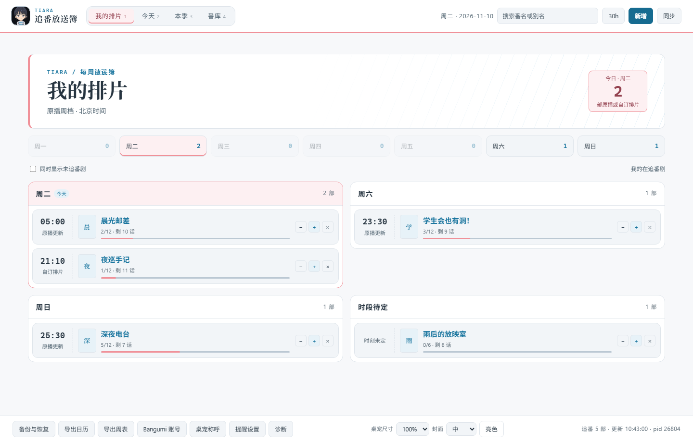

# TIARA · 伪春菜番组管家

把这周想看的番交给桌上的 TIARA。她能帮你记进度、看原播时间，也能在你设定的时刻提醒你。

当前版本 v0.59.0 · 2026-11-19

## 下载

从 [GitHub 最新发布](https://github.com/JerryVon39/TIARA/releases/latest) 选择适合你的 ZIP。已有番库的读者可以先看下方的「升级或换电脑」，在新目录里预览并导入旧数据。发布页也提供 SHA-256 校验清单。

| 下载文件 | 适合谁 |
| --- | --- |
| `TIARA-portable-版本号.zip` | 想在 Windows 上直接运行桌宠和网页追番面板。解压后启动，包内已有运行时。 |
| `TIARA-ssp-版本号.zip` | 已经在用 SSP，想安装 TIARA 人格、使用案件簿与排片快照。安装需要 SSP 和 YAYA。 |

## 第一次打开

1. 在 Windows 上把 **TIARA 便携包完整解压**到一个文件夹。包内已带网页运行时，无需另装 Node.js。
2. 双击 **`启动TIARA.bat`** 或 **`pet/Pet.exe`**。桌宠会在后台启动本地网页。
3. 右键桌宠，选择 **「打开网页面板」**。点顶栏 **「新增」**，可以手填番名，也可以粘贴 Bangumi 条目链接。确认已完播的番会默认加入「补番」，保存前可以更改观看方式。

只想用网页时，双击 **`打开番组表.bat`**。番库保存在这台电脑上，手动加番、改进度都可以离线完成。

[查看桌宠右键菜单截图](docs/images/pet-menu.png)

## 平时怎么用

| 想做什么 | 在哪里操作 |
| --- | --- |
| 看一周哪天播 | 网页「我的排片」可切换「今天 / 本周」，也可点放送日历跳到某天。桌宠右键「查看我的排片」可按星期筛选，今日提醒和待补番在「提醒与待补」。网页「设置」里的排片时制会同步到桌宠。 |
| 记一话 | 点排片卡片上的「记一话」。误点可立即撤销，也可从卡片的「更多操作」退回一话或打开每话清单。桌宠右键 →「记一话」可选番，桌宠排片表里的 `−1` 可以退回一话。 |
| 改已看集数或提醒时间 | 点番名先看观看进度、播放入口和下次提醒。展开「进度」可更正集数，展开「排期与提醒」可对照原播时间、本机排片和实际提醒时间，再手填本机排片或采纳查到的原播时段。 |
| 直接打开观看页 | 在番剧详情填写自己的 HTTP 或 HTTPS 链接。保存后，网页和桌宠的排片里会出现「去观看」。链接随番库一起迁移。 |
| 补看旧番 | 在网页「补番」点「新增补番」，手动填番名和已看集数，或粘贴 Bangumi 条目链接读取资料。已有番剧可在详情切换观看方式，原排期和进度会保留。清单上可以直接去观看、记一话。 |
| 整理已经播完的在追番 | 在「我的排片 → 本周」或「番库」点「查找已完播待补」。需要时点「联网核对本页」，查看完播依据，再勾选、预览和确认。转入后保留进度、观看历史和原播资料，可单独设补番提醒。 |
| 找以前看过的番 | 在任一页面的顶栏搜索番名或别名。全番库结果单独显示，可按状态筛选，点番名打开详情。清空或按 Esc 返回刚才的页面。 |
| 找其他季度的番 | 在「本季」或全番库搜索结果里点「跨季度找番」，输入中文名、原名或别名，按年份、类型和封面核对。候选会标出已入库或可能同名的条目。搜索不可用时可查本地缓存或离线手动添加。 |
| 先收藏一部番 | 添加番剧时，将观看方式设为「加入待看」。以后到「番库 → 待看」打开详情，再选择「开始追连载」或「开始补番」。 |
| 查前传、续集和外传 | 已关联 Bangumi 的番剧可在详情打开「续作与观看顺序」。按原名、关系和条目编号核对版本，可上移或下移后保存自己的观看顺序。 |
| 将手动番剧关联到 Bangumi | 打开详情的「绑定 Bangumi」，输入条目链接或编号。合并前先填写首播年份，在预览核对首播日期、周档、进度和观看历史。两边手填周档不同时，先选保留哪个。 |
| 一次整理多部番 | 在「番库」点「批量整理」并选择条目。可加标签、转入补番或归档已看完的番。确认前可预览范围和跳过原因，执行后可一次撤销。 |
| 弃番后继续，或从头重看 | 在番剧详情标为弃番，可写备注。回到「番库 → 已弃番」可从原进度继续，也可和已看完或归档的番一样另开一轮重看，首轮进度仍可查看。 |
| 整理番剧 | 详情里的「整理标签、笔记与观看入口」可设置年份、自订标签、默认折叠的剧透笔记和首选播放入口。番库能组合筛选并保存视图。 |
| 接着看或补记 | 「我的排片」上方列出最近观看和置顶的番。番剧详情可按实际观看日期补记，「番库 → 观看历史」支持筛选与导出。 |
| 撤销一笔误记 | 在「观看历史」展开记录，点「撤销这笔记录」。预览显示当前进度、保留的后续记录和统计变化，确认后再写入。若期间手动重设或同步覆盖过进度，先到详情核对。 |
| 跳集看或回补 | 在详情选「首轮每话清单」或「本轮每话清单」。可离线勾选集数，也可输入 `1、2、4`。这会记为累计 3 集、连续至第 2 集。Bangumi 正片标题默认隐藏，需要时再展开。 |
| 看每周记了几集 | 「番库 → 本地周报」可以切换周次，查看追连载、补番和重看各记了几集，以及哪部番在那周看完。可打开同期记录核对。 |
| 找回误加的番 | 详情的「移除误加条目」会停止提醒，保留排期、进度和历史。到「番库 → 已移除」打开详情即可找回到原分组。 |
| 调整首页 | 从网页顶栏打开「设置」，可选择启动时显示排片、接着看或补番，也可为本周排片启用紧凑列表。 |
| 安排补番时间 | 在补番详情选择星期和个人观看时间。「补番」页还可以设置每周想看的集数，按北京时间周一至周日统计，撤销记账后会同步扣回。 |
| 看提醒会不会响 | 番剧详情显示下一次实际提醒及静音、暂停、免打扰等状态。「设置 → 提醒设置」可以向运行中的便携版桌宠发一条测试提醒。 |
| 回看刚才的提醒 | 从网页「设置」或桌宠菜单打开「提醒记录」，查看开播、补番、稍后和测试提醒。点番名可打开详情。记录保存在这台电脑上。 |
| 延后或取消提醒 | 在提醒气泡或网页「提醒记录」选择「15 分钟后提醒」。再去网页提醒设置或桌宠托盘「稍后提醒」调整或取消。原排期改动、暂停后继续、归档或静音都会让旧提醒失效。 |
| 避开不合适的时段 | 「提醒设置」可分别设置工作日和周末免打扰、准点或提前提醒。跨午夜按开始那一天的规则，时间使用北京时间。 |
| 导出日历 | 在「设置 → 导出日历」勾选开播、个人补番和闹铃，指定日期范围。导出使用北京时间，周一 25:30 会落在周二 01:30。 |
| 找回休眠期间的提醒 | 电脑唤醒或桌宠重启后，TIARA 会把最近 6 小时内符合条件的开播和补番合成一条「错过提醒摘要」。原定时刻或恢复时落在免打扰时段的提醒会跳过，详情可在「提醒记录」查看。 |
| 翻陪伴手账 | 右键桌宠 →「和她聊聊」→「陪伴手账」，查看好感、回看剧情和第一次一起值日的日期。「最近台词」保留 12 句，可复制或收藏。手账的「偏好」可以分别开关主动问候和整点报时。 |
| 调整气泡阅读 | 右键桌宠 →「桌宠设置」→「换装与气泡」，可延长停留、改为手动关闭，或减弱动画并立即显示全文。阅读和选择期间会顺延闲聊，开播提醒仍可从托盘和提醒记录找到。 |
| 读节日来信 | 1 月 1 日至 7 日启动桌宠，会收到一封元旦来信。可以到「陪伴手账」→「来信」拆开，之后随时回看。安静时也能打开。 |
| 朗读和对白试演 | 在「最近台词」或「收藏」点击「朗读」，语速和静音在手账「偏好」。Windows 需有可用的中文语音。手账的「对白试演」可切换单气泡和双气泡，逐句阅读。 |
| 专注或安静一会儿 | 右键桌宠 →「专注与安静」，开始、暂停、继续或结束计时，也可以临时安静 15、30 或 60 分钟，暂停闲聊和通知。「开播与补番提醒只走托盘」可以独立开启。 |
| 记一张桌面便条 | 右键桌宠 →「桌面便条」。可以按内容或关联番剧检索、切换排序、设置本机到期时间。到期通知走托盘，专注和免打扰结束后再发。完成后仍可恢复。 |
| 找回桌宠 | 点托盘菜单的「找回桌宠」，桌宠会回到鼠标所在屏幕。也可在「显示与召回」启用 Ctrl + Alt + Shift + T，以及本屏全屏时暂时隐藏。 |
| 固定常用入口 | 从托盘「常用菜单设置」或桌宠右键「桌宠设置」→「常用菜单」分别选择，每处最多固定 3 项。「最近使用」可以找回刚开的排片、便条或手账。 |
| 玩一局猜数字 | 右键桌宠 →「和她聊聊」→「猜数字」。在 1 到 20 中猜一个数，最多 5 次。关闭窗口再回来可接着玩这一局。 |
| 换装、改气泡或玩猜拳 | 「桌宠设置」→「换装与气泡」可以预览立绘、配色和字号。「和她聊聊」→「猜拳」会在气泡里开一局。 |
| 暂停、静音或归档 | 在详情里操作。看完最后一集会移入「番库」的「已看完」，同时退出排片与提醒。总集数未知时可手动标为已看完。归档的番在「番库」里也能找到。 |
| 同步 Bangumi | 在「设置 → Bangumi 账号」填写访问令牌并测试连接。通过「设置 → 同步 Bangumi」核对线上状态，勾选要写入的番剧和字段，再确认。在线失败可重试，或选择预览上次读完的缓存。 |
| 换颜色或调整桌宠 | 网页「设置」可切换亮色、暗色或跟随系统，也能调整桌宠尺寸。右键 Windows 托盘的 TIARA 图标，可以直接选「置顶」「普通」「沉底」，也能找回隐藏的桌宠。 |

原播周档按北京时间显示。例如开启 30 小时制后，周一凌晨 01:30 会显示为周日 25:30。桌宠仍按详情里设置的实际时刻提醒。同刻开播的番剧会合成一条通知。

想用自己的立绘套装，可以在 `shell` 下建一个目录，把首张图片命名为 `surface0.png`，再打开「换装与气泡」预览。包内的 `master` 和 `tiara2` 使用同一套立绘素材。

## 升级或换电脑

1. 把新版便携包解压到新目录，退出旧版 TIARA。
2. 在网页 **「设置 → 升级与换机」** 打开备份和导入工具，可附带桌面便条、桌宠外观与聊天偏好、收藏台词和当前浏览器的网页偏好。新版可以读取备份，也可以直接选择旧版的 `data` 文件夹。网页主题、首页、封面大小和番库视图从浏览器导出，旧文件夹里没有这些偏好。
3. 先核对番库数量、陪伴记忆以及选中的桌宠资料，再确认恢复。勾选「收藏台词」后，预览会显示替换前后的收藏数量。确认后，恢复前的数据会另存到 `data/backups`。
4. 外观会带上立绘套装名称、气泡配色、字号和桌宠尺寸。自定义立绘请另行复制套装文件夹到新版的 `shell`。预览会提示新机缺少的立绘，确认后会先用默认套装。
5. 若启用了开机自启，在升级向导核对原路径，再到新桌宠右键 →「桌宠设置」→「开机自启路径」确认切换。要同步 Bangumi，请在新安装里重新填写令牌。最近台词与进行中的计时留在原安装目录。

想核对本机有多少备份，到「备份与恢复」查看番库回滚、每日快照和迁移前备份的范围、占用与保留时间。新生成的每日快照也会排除 Bangumi 账号配置。

原来的番库如果放在 Excel 等表格中，可以到「番剧库」→「导入 CSV」下载模板。填写标题、已看集数、总集数、年份和 Bangumi 编号，以 UTF-8 CSV 保存。只有标题必填；年份和编号有助于区分同名的不同季。先核对重复和无效行，再选要新增的番剧。番剧详情也可以重试单部封面，获取过的有效封面可离线查看。

## 使用 SSP 人格包

把 SSP 包拖进 [SSP](https://ssp.shillest.net/)，或把其中的 `ghost` 和 `shell` 解压到 `SSP/ghost/tiara-yaya/`。按包内 `readme.txt` 把 [YAYA](https://github.com/YAYA-shiori/yaya-shiori/releases) 的 `yaya.dll` 和 [SHIORIES](https://github.com/YAYA-shiori/shiories/releases) 的 `yaya_base` 放到人格的 `ghost/master/`，然后重新载入人格。

双击 TIARA 可以打开案件簿。公开 SSP 安装包从空番库开始。想把自己的排片带到 SSP，可在便携版网页点「设置」→「导出私人 SSP 排片」。确认七天的提醒范围后下载 ZIP，安装进自己的 SSP 并重载 TIARA。私人 ZIP 含本机排片和称呼，请自行保管。日常记进度、网页同步、陪伴手账和便条使用 Windows 便携版。

网页「设置」→「检查更新」可比较正在使用的版本和 GitHub 正式发行版，查看下载链接及发行包的 SHA-256。

「导出日历」下有本机日历订阅试验。支持直接读取本机 HTTP 订阅的日历客户端可使用其中的地址，查看接下来 28 天的在追和补番排期。面板服务需保持运行，刷新间隔由日历客户端决定。

已绑定 Bangumi 且有本机观看记录的动画，可以在详情打开「回写一集到 Bangumi」。先核对账号和这一集的线上状态，再确认标为已看。确认时由 Bangumi 校验令牌的收藏写权限。

网页「设置」→「打开副屏看板」会打开独立只读窗口，可移到另一块屏幕全屏浏览接下来七天和下一档排片。按 Esc 可退出全屏或返回面板。

## 遇到问题时

- **桌宠不见了**。右键 Windows 托盘区的 TIARA 图标，选择「找回桌宠」，把立绘带回鼠标所在的屏幕。沉底时会暂时浮到前面。
- **网页打不开**。确认便携包已完整解压。双击 `停止TIARA.bat` 后再打开，网页提示后台版本较旧时也可以这样重启。
- **启动后还是旧版**。「设置 → 启动诊断」会列出启动脚本指向的文件、磁盘上的桌宠以及正在运行的版本。退出旧实例后，从新版解压目录启动 `pet/Pet.exe`。
- **番剧没有原播周档**。公开数据有时缺少播出时刻，可以打开详情手动填一个提醒时间。
- **想找回某天的番库或单部番剧**。「设置 → 备份与恢复」可回滚进度、状态和排期。如果也要恢复到备份里的观看历史，用「升级与换机」导入完整备份。

[开发文档](docs/DEVELOPMENT.md) · [版本记录](docs/CHANGELOG.md)
