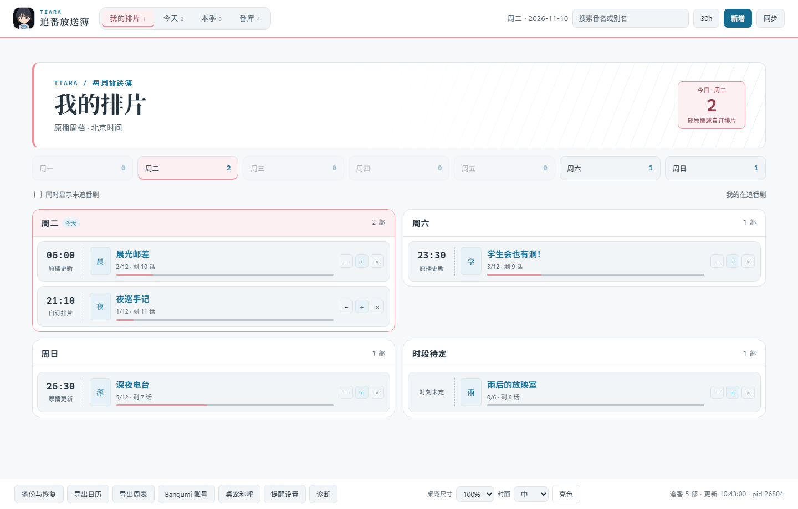

# TIARA · 伪春菜番组管家

把这周想看的番交给桌上的 TIARA。她能帮你记进度、看原播时间，也能在你设定的时刻提醒你。

当前版本 v0.27.8 · 2026-11-10

## 第一次打开

1. 在 Windows 上把 **TIARA 便携包完整解压**到一个文件夹。包内已带网页运行时，无需另装 Node.js。
2. 双击 **`启动TIARA.bat`** 或 **`pet/Pet.exe`**。桌宠会在后台启动本地网页。
3. 右键桌宠，选择 **「打开网页面板」**。点顶栏 **「新增」**，填一个番名就能加入在追。

只想用网页时，双击 **`打开番组表.bat`**。番库保存在这台电脑上，手动加番、改进度都可以离线完成。

[查看桌宠右键菜单截图](docs/images/pet-menu.png)

## 平时怎么用

| 想做什么 | 在哪里操作 |
| --- | --- |
| 看一周哪天播 | 网页「我的排片」，或桌宠右键「查看我的排片」。桌宠里可以按星期筛选，今日提醒和待补番在「提醒与待补」。网页顶栏的 `30h / 24h` 会同步到桌宠。 |
| 记一话 | 点番剧旁的 `＋`，或右键桌宠 →「记一话」→ 选番。桌宠排片表里的 `−1` 可以退回一话。 |
| 改已看集数或提醒时间 | 点番名打开详情。可以手填星期和时间，也可以「联网查时刻」后采纳原播时段。 |
| 暂停、静音或归档 | 在详情里操作。想继续追时，从「番库」找到原来的条目。 |
| 同步 Bangumi | 在网页底栏打开「Bangumi 账号」，填写访问令牌并测试连接。点「同步」预览改动后，再确认是否应用。 |
| 换颜色或调整桌宠 | 网页底栏切换亮色、暗色或跟随系统。桌宠右键「桌宠设置」可改尺寸、层级、省电和开机自启。 |

原播周档按北京时间显示。例如开启 30 小时制后，周一凌晨 01:30 会显示为周日 25:30。桌宠仍按详情里设置的实际时刻提醒。

## 遇到问题时

- **桌宠不见了**。看看 Windows 右下角的托盘区，双击 TIARA 图标可以找回来。
- **网页打不开**。确认便携包已完整解压。双击 `停止TIARA.bat` 后再打开，网页提示后台版本较旧时也可以这样重启。
- **番剧没有原播周档**。公开数据有时缺少播出时刻，可以打开详情手动填一个提醒时间。
- **想备份或换电脑**。退出 TIARA 后备份整个 `data` 文件夹。更新时把它留在自己的电脑上，再复制到新版的解压目录。网页底栏的「备份与恢复」也可以预览可用的备份。

[开发文档](docs/DEVELOPMENT.md) · [版本记录](docs/CHANGELOG.md)
